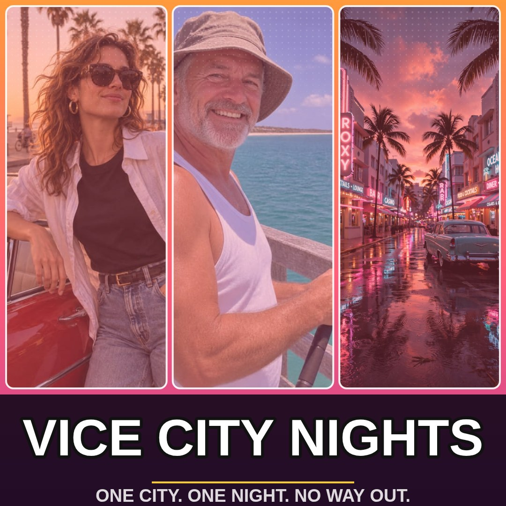

# Vice Cover Maker

[](https://make.fun/bounty/gta6-cover-art-01?utm_source=github&utm_medium=readme&utm_campaign=gta6-cover-art-01)
[](https://make.fun/bounty/gta6-cover-art-01/leaderboard?utm_source=github&utm_medium=readme&utm_campaign=gta6-cover-art-01)
[](https://make.fun/bounty/gta6-cover-art-01?utm_source=github&utm_medium=readme&utm_campaign=gta6-cover-art-01)

A web app that turns your photos and a caption into a GTA-style poster cover: three photo panels (one big hero, two small), a Vice City sunset or neon colour grade, halftone dots, and bold outlined caption lettering — exported as a PNG to share.



## How it works

1. Pick a panel (Hero, 2 or 3) and load a photo into it — or use the two bundled sample photos.
2. Drag the photo on the preview to move it; use Zoom to fill the panel.
3. Write your caption and sub-caption, pick a colour grade (Sunset, Neon or Noir) and an export size.
4. Hit **Export PNG** — 1080 x 1080, 1080 x 1350 or 1920 x 1080.

Everything runs offline in the browser: your photos are read on your own machine and never uploaded. No Rockstar logos, artwork or fonts — the design is original.

## Run it

Serve the `app/` folder with any static server, then open `app/index.html` in desktop Chrome:

```sh
node serve.ts
# open http://localhost:8080
```

Built for the [make.fun](https://make.fun) gta6-cover-art-01 bounty.

## License

MIT
